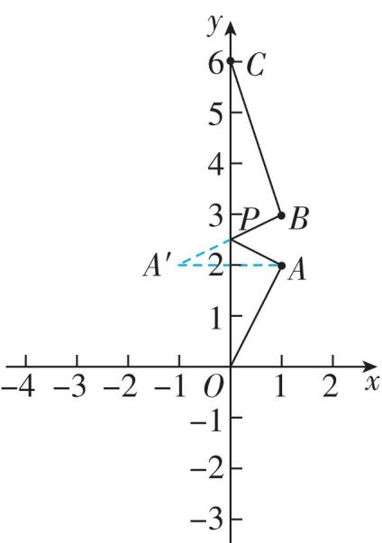
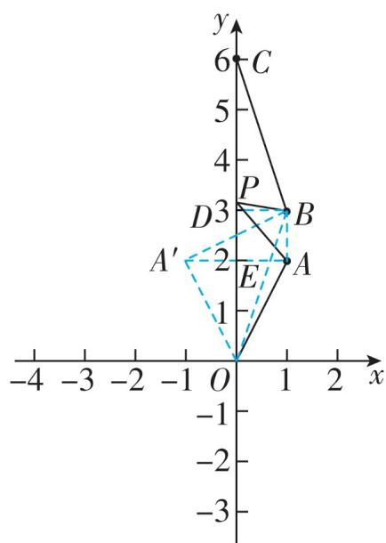

> [!success]- 必刷题
>
> > [!success] **【答案】** $\left(0,\frac{5}{2}\right)$
>
> > [!note]- **【解析】**
> > (1)如图(1), 因为 $A(1,2)$ , $B(1,3)$ , $C(0,6)$ , 所以 OA, BC 是定长, 所以当点 P 在线段 OC 上时, $\triangle OAP$ 与 $\triangle CBP$ 周长的和取得最小值. 因为 $OP + PC = OC = 6$ , 所以 $\triangle OAP$ 与 $\triangle CBP$ 周长的和为 $OA + AP + OP + PC + BC + BP = OA + BC + OC + AP + BP$ , 所以当 $AP + BP$ 的值最小时, $\triangle OAP$ 与
> >
> > 连接 OC, 根据轴对称的性质得 OC = OB = 1, 再根据三角形三边关系即可求解.
> >
> > ## 思路分析
> >
> > ## 思路分析
> >
> > (1) 由题意可得当 $AP + BP$ 的值最小时, $\triangle OAP$ 与 $\triangle CBP$ 周长的和取得最小值. 作点 $A$ 关于 $y$ 轴的对称点 $A'$ , 连接 $A'B$ , 则 $A'B$ 与 $y$ 轴的交点即为所求的点 $P$ . 由题意易知 $P$ 是 $A'B$ 的中点, 由中点坐标公式可求得点 $P$ 的坐标.
> >
> > △CBP 周长的和取得最小值. 作点 A 关于 y 轴的对称点 $A'$ ，连接 $A'B$ ，则 $A'B$ 与 y 轴的交点即为所求的点 P. 易得 $A'(-1,2)$ ，P 是 $A'B$ 的中点，所以 $P\left(\frac{1-1}{2},\frac{2+3}{2}\right)$ ，即 $P\left(0,\frac{5}{2}\right)$ . 故答案为 $\left(0,\frac{5}{2}\right)$ .
> >
> > 
> > 图(1)
> >
> > (2)如图(2),过点B作 $BD\perp OC$ 于D,作点A关于y轴的对称点 $A^{\prime},AA^{\prime}$ 交y轴于点E,连接 $A^{\prime}B$ , $OA^{\prime},OB,AB$ .
> > 因为 CD = OD = 3，所以 BC = OB，所以 $\angle BCO = \angle BOC$ 由轴对称的性质得
> >
> > 
> > 图(2)
> >
> > $OA = OA'$ , $\angle OAE = \angle OA'E$ , $\angle AOE = \angle A'OE$ . 因为 $AB = AE = 1$ , $AA' = OE = 2$ , $\angle BAA' = \angle AEO = 90^\circ$ , 所以 $\triangle A'AB \cong \triangle OEA$ (SAS), 所以 $\angle BA'A = \angle AOE$ , $A'B = OA = OA'$ . 因为 $\angle AOE + \angle OAE = 90^\circ$ , 所以 $\angle OA'E + \angle AA'B = 90^\circ$ , 即 $\angle BA'O = 90^\circ$ . 因为 $A'B = OA = OA'$ , 所以 $\triangle OA'B$ 是等腰直角三角形, $\angle BOA' = 45^\circ$ , 所以 $\angle BOD + \angle A'OE = \angle BCD + \angle AOE = 45^\circ$ . 因为 $\angle APB = 40^\circ$ , 所以 $\angle ABP + \angle BAP = 140^\circ$ , 所以 $\angle OAP + \angle PBC = 360^\circ - 140^\circ - 45^\circ = 175^\circ$ , 故答案为 $175^\circ$ .
