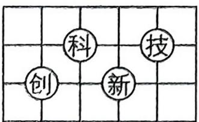
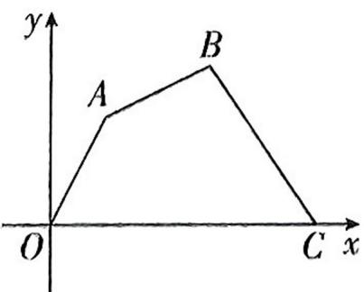

<!-- question-source:start -->
3 [2024 贵州中考]为培养青少年的科学态度和科学思维,某校创建了“科技创新”社团. 小红将“科”“技”“创”“新”写在如图所示的方格纸中,若建立平面直角坐标系,使“创”“新”的坐标分别为(-2,0),(0,0),则“技”所在的象限为( )

A. 第一象限
B. 第二象限
C. 第三象限
D. 第四象限

(第3题图)

(第4题图)
<!-- question-source:end -->

![[Q00105908A1]]
