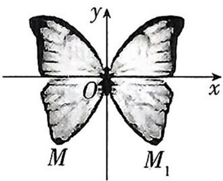
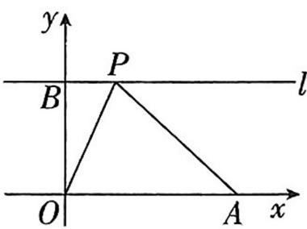

<!-- question-source:start -->
7 [2024 四川绵阳中考] 蝴蝶颜色炫丽,翩翩起舞时非常美丽,深受人们喜爱,它的图案具有对称美.如图,蝴蝶图案关于 y 轴对称,点 M 的对应点为 $M_{1}$ , 若点 M 的坐标为 $(-2,-3)$ , 则点 $M_{1}$ 的坐标为
( )
A. (2, -3) B. (-3, 2)
C. (-2, 3) D. (2, 3)

(第7题图)

(第8题图)
<!-- question-source:end -->

![[Q00105912A1]]
