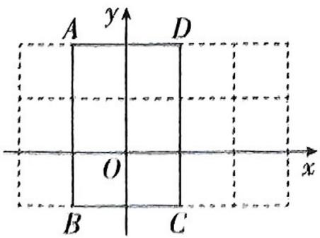
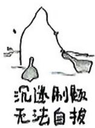

<!-- question-source:start -->
4[2025 安徽合肥期中]如图,平面直角坐标系中长方形 ABCD 的四个顶点坐标分别为 A(-1, 2), B(-1,-1), C(1,-1), D(1,2), 点 P 从点 A 出发,沿长方形的边顺时针运动,速度为每秒 2 个单位长度,同时点 Q 从点 A 出发,沿长方形的边逆时针运动,速度为每秒 3 个单位长度,记 P,Q 在长方形边上第 1 次相遇时的点为 M₁, 第二次相遇时的点为 M₂,第三次相遇时的点为 M₃,…,则点 M₂₀₂₅ 的坐标为 ( )

A. $(1,0)$ B. $(1,2)$ C. $(-1,2)$ D. $(0, - 1)$
<!-- question-source:end -->

![[Q00105917A1]]
