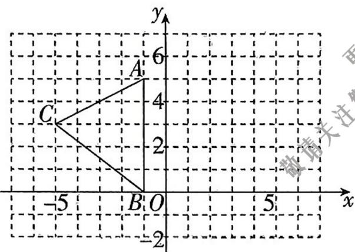

<!-- question-source:start -->
7 如图, 在平面直角坐标系中, $\triangle ABC$ 的顶点坐标为 $A(-1,5), B(-1,0), C(-5,3)$ .

$$
\triangle A B C
$$

$$
\triangle A _ {1} B _ {1} C _ {1}
$$

$$
A _ {1}, B _ {1}, C _ {1}
$$

(2) 直接写出 $A_{1}, B_{1}, C_{1}$ 三点的坐标: $A_{1}(\quad), B_{1}(\quad), C_{1}(\quad)$ .

<!-- question-source:end -->

![[Q00105920A1]]
