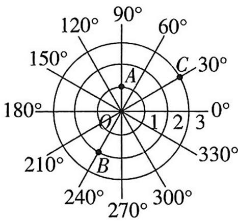
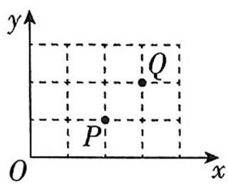

<!-- question-source:start -->
1. [2024 四川甘孜州中考]如图,在一个平面区域一台雷达探测器测得在点 A, B, C 处有目标见. 按某种规则, 点 A, B 的位置可以分别表示为 $(1, 90^{\circ})$ , $(2, 240^{\circ})$ , 则点 C 的位置可以表示为 \_\_\_\_.

(第1题图)

(第2题图)
<!-- question-source:end -->

![[Q00106380A1]]
