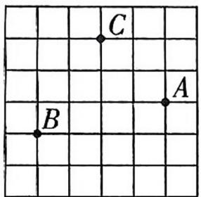
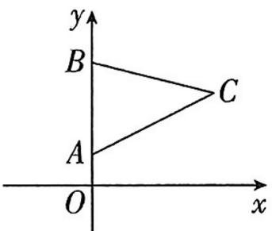

<!-- question-source:start -->
1. DPSK 原创 2025 年 2 月 17 日,《哪吒之魔童闹海》成为中国首部进入全球影史票房榜前十的电影. 如图是某影院部分座位平面示意图, 若座位 A 的坐标为 (3,2), 座位 B 的坐标为 (-1,1), 则座位 C 的坐标为 ( )
A. (1,4) B. (4,1) C. (0,3) D. (3,0)

(第1题图)

(第3题图)
<!-- question-source:end -->

![[Q00106381A1]]
