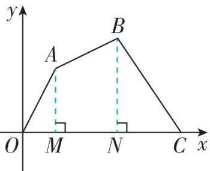

> [!success]- 必刷题
>
> > [!success] **【答案】** D
>
> > [!note]- **【解析】**
> > 过 A 作 $AM \perp OC$ 于 M，过 B 作 $BN \perp OC$ 于 N，如图。因为 $O(0,0)$ ， $A(1,2)$ ， $B(3,3)$ ， $C(5,0)$ ，所以 OM = 1，AM = 2，ON = BN = 3，CO = 5，所以 MN = ON - OM = 2，CN = OC - ON = 2，所以四边形 OABC 的面积为 $S_{\triangle AOM} + S_{梯形AMNB} + S_{\triangle BCN} = \frac{1}{2} \times 1 \times 2 + \frac{1}{2} \times (2 + 3) \times 2 + \frac{1}{2} \times 3 \times 2 = 9$ 。故选 D。
> >
> > 
