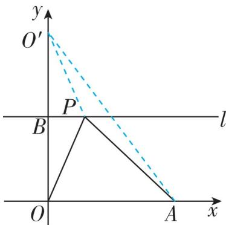

> [!success]- 必刷题
>
> > [!success] **【答案】** A
>
> > [!note]- **【解析】**
> > 由题意得, 点 $M(-2, -3)$ 与点 $M_{1}$ 关于 $y$ 轴对称, 所以点 $M_{1}$ 的坐标为 $(2, -3)$ . 故选 A.
> >
> > 8.5 取点 $O'(0,4)$ , 连接 $O'P, O'A$ , 如图. 因为 $B(0,2)$ , 直线 $l$ 垂直于 $y$ 轴, 所以点 $O'(0,4)$ 与点 $O(0,0)$ 关于直线 $l$ 对称, 所以 $PO' = PO$ ,所以 $PO + PA = PO' + PA \geqslant O'A$ ，即 $PO + PA$ 的最小值为 $O'A$ 的长。在 Rt $\triangle O'AO$ 中，因为 $OA = 3, OO' = 4$ ，所以由勾股定理，得 $O'A = \sqrt{OA^2 + OO'^2} = \sqrt{3^2 + 4^2} = 5$ ，所以 $PO + PA$ 的最小值为 5。故答案为 5。
> >
> > 
