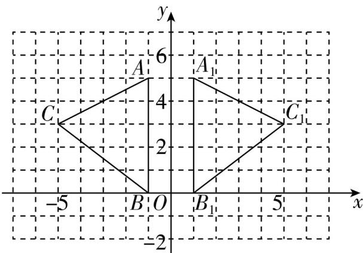

> [!success]- 必刷题
>
> > [!success] **【答案】** 1,5,1,0,5,3
>
> > [!note]- **【解析】**
> > 【解】(1)如图所示, $\triangle A_{1}B_{1}C_{1}$ 即为所求.
> >
> > 
> >
> > (2)根据(1)的图形可知 $A_{1}(1,5), B_{1}(1,0)$ , $C_{1}(5,3)$ . 故答案为 1,5,1,0,5,3.
