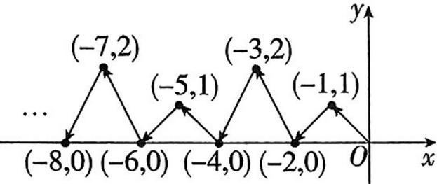

<!-- question-source:start -->
1 [中]如图, 动点 $P$ 在平面直角坐标系中按图中箭头所示方向运动, 第 1 次从原点运动到点 $(-1, 1)$ , 第 2 次接着运动到点 $(-2, 0)$ , 第 3 次接着运动到点 $(-3, 2), \cdots$ , 按这样的运动规律, 经过第 2023 次运动后, 动点 $P$ 的坐标是 ( )

A. $(-2023, 0)$ B. $(-2023, 1)$ C. $(-2023, 2)$ D. $(2023, 0)$
<!-- question-source:end -->

![[Q00105902A1]]
