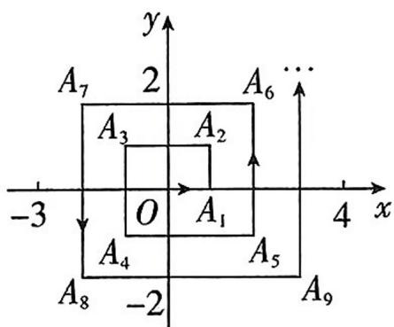
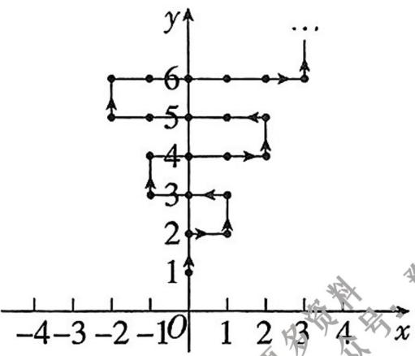

<!-- question-source:start -->
4[中]如图,一机器人从原点出发按图示方向做折线运动,第1次从原点运动到 $A_{1}(1,0)$ ,第2次运动到 $A_{2}(1,1)$ ,第3次运动到 $A_{3}(-1,1)$ ,第4次运动到 $A_{4}(-1,-1)$ ,第5次运动到 $A_{5}(2,-1),\cdots$ ,则第15次运动到的点 $A_{15}$ 的坐标是
()
A. (4,4) B. (-4,4)
C. (-4,3) D. (5,-4)

(第4题图)
(第5题图)
<!-- question-source:end -->

![[Q00105904A1]]
