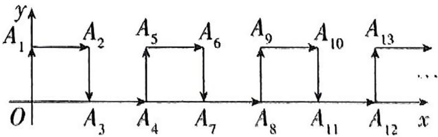

<!-- question-source:start -->
6[中]如图,在平面直角坐标系中,一动点从原点O出发,按向上、向右、向下、向右的方向依次平移,每次平移一个单位,得到点 $A_{1}(0,1)$ , $A_{2}(1,1)$ , $A_{3}(1,0)$ , $A_{4}(2,0)$ , …, 那么点 $A_{21}$ 的坐标为 \_\_\_\_.

是个新“烤”鸭

电子错题本鸭
<!-- question-source:end -->

![[Q00105906A1]]
