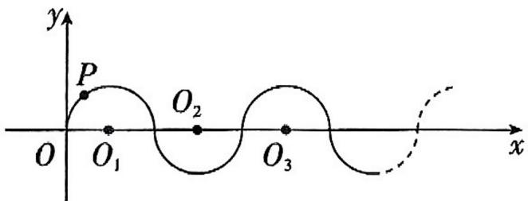

<!-- question-source:start -->
2[2025 安徽安庆期末, 中]如图所示, 在平面直角坐标系中, 半径均为 1 个单位长度的半圆 $O_{1}$ , 半圆 $O_{2}$ , 半圆 $O_{3}, \cdots$ 组成一条平滑的曲线, 点 $P$ 从原点 $O$ 出发, 沿这条曲线向右运动, 速度为每秒 $\frac{\pi}{2}$ 个单位长度, 则第 2021 秒时, 点 $P$ 的坐标是 ( )

A. (2020,0) B. (2021,-1) C. (2021,1) D. (2022,0)
<!-- question-source:end -->

![[Q00106378A1]]
