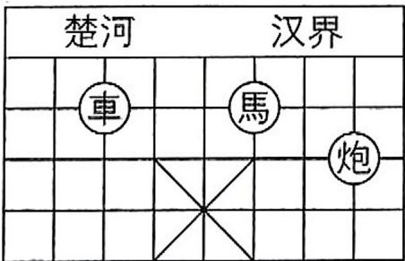

<!-- question-source:start -->
3 新考向传统文化 [2025 江西南昌质检] 中国象棋历史悠久, 是中国传统文化的重要组

成部分,且作为棋类项目,它趣味浓厚,基本规则简明易懂,深受人们喜爱. 观察如图所示的部分象棋盘,以“炮”为原点,分别以正东、正北方向为 $x$ 轴、 $y$ 轴的正方向建立平面直角坐标系,则“馬”的坐标是 \_\_\_\_.
<!-- question-source:end -->

![[Q00105853A1]]
