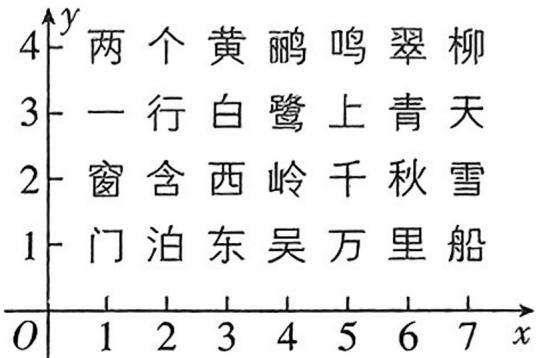

<!-- question-source:start -->
4[2025 河北石家庄调研]如图,我们把杜甫的《绝句》整齐排列在平面直角坐标系中.
(1)“岭”和“船”的坐标依次是\_\_\_\_；
(2)将第2行与第3行对调,再将第3列与第7列对调,“雪”由开始的坐标依次变换为\_\_\_\_

建议用时 20 分钟 答案 D23

和\_\_\_\_；

(3)“泊”开始的坐标是(2,1),使它的坐标变换为(5,3),应该哪两行对调,同时哪两列对调?

<!-- question-source:end -->

![[Q00105854A1]]
