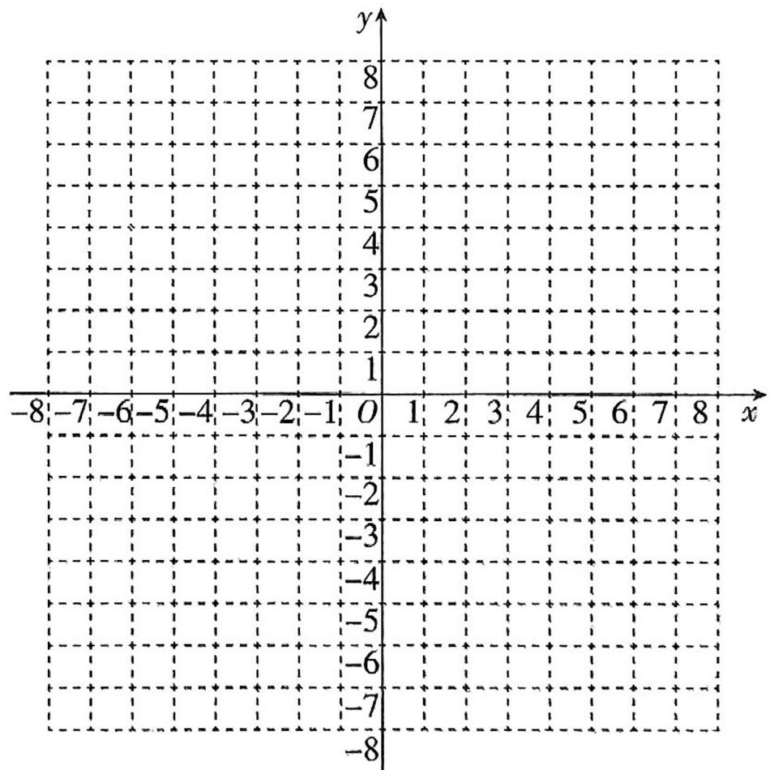

<!-- question-source:start -->
5[2025 甘肃庆阳期末]如图,在所给的平面直角坐标系中描出下列各点:(1,8),(-2,2),(0,2),(0,-6),(2,-6),(2,2),(4,2),(1,8).依次连接各点,观察所得到的图形,你觉得它像什么?

② 刷易错 ▶ 小心有坑\~

<!-- question-source:end -->

![[Q00105855A1]]
