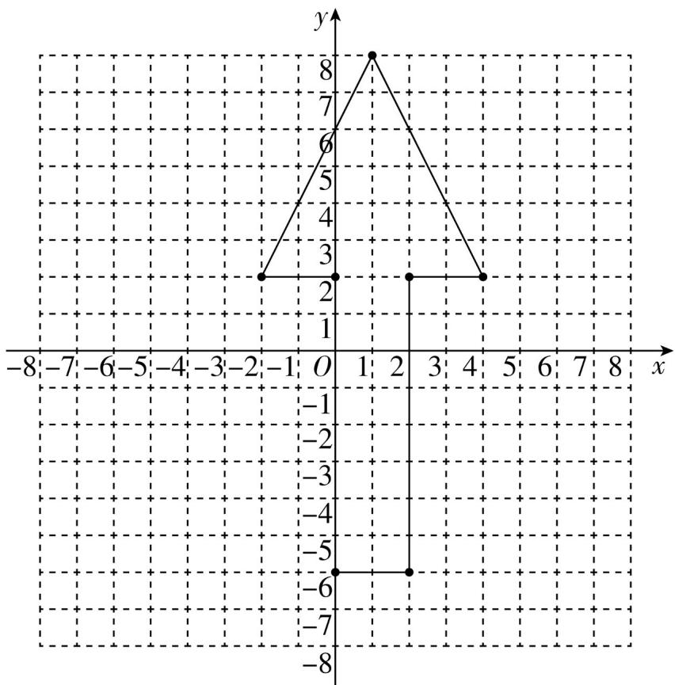

> [!success]- 必刷题
>
> > [!success] **【答案】** 详见解析
>
> > [!note]- **【解析】**
> > 【解】如图所示即为所求. 得到的图形像一个箭头(答案合理即可).
> >
> > 
> >
> > 刷有所得第一、三象限角平分线上点的横、纵坐标相等；第二、四象限角平分线上点的横、纵坐标互为相反数.
> >
> > ## 易错警示
> >
> > ## 刷易错·
