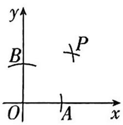
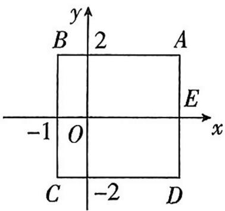

<!-- question-source:start -->
4[2025 山东聊城质检, 中]如图, 点 $A, B$ 分别在 $x$ 轴、 $y$ 轴上, $OA = OB$ , 分别以点 $A, B$ 为圆心, 以大于 $\frac{1}{2} AB$ 长为半径画弧, 两弧交于点 $P$ . 若点 $P$ 的坐标为 $(a, 3a - 4)$ , 则 $a$ 的值为 \_\_\_\_.

(第4题图)
(第5题图)
<!-- question-source:end -->

![[Q00105870A1]]
