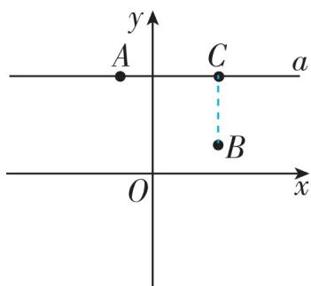

> [!success]- 必刷题
>
> > [!success] **【答案】** C
>
> > [!note]- **【解析】**
> > 如图所示. 因为直线 $a \parallel x$ 轴, 点 $C$ 是直线 $a$ 上的一个动点, 点 $A(-1,3)$ , 所以设点 $C(x, 3)$ . 因为当 $BC \perp$ 直线 $a$
> >
> > 
> >
> > 时,线段 BC 的长度最短,且点 $B(2,1)$ ,所以 x=2,所以点 C 的坐标为 $(2,3)$ .
