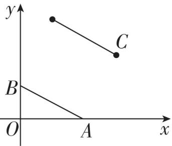
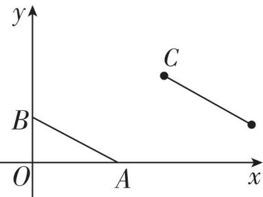

> [!success]- 必刷题
>
> > [!success] **【答案】** (1,3)或(5,1)
>
> > [!note]- **【解析】**
> > - **①**：如图(1),当A平移到点C时,因为C(3,2),A(2,0),B(0,1),所以平移方式为向上平移2个单位,向右平移1个单位,所以平移后的点B坐标为(1,3);
> > - **②**：如图(2),当B平移到点C时,因为C(3,2),A(2,0),B(0,1),所以平移方式为向上平移1个单位,向右平移3个单位,所以平移后的点A坐标为(5,1).故答案为(1,3)或(5,1).
> >
> > 分两种情况: ①当 A 平移到点 C 时;
> > - **②**：当 B 平移到点 C 时, 分别利用平移中点的坐标变化规律求解即可.
> >
> > 
> > 图(1)
> >
> > 
> > 图(2)
> >
> > ## 刷素养·
