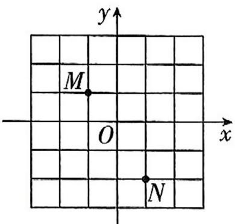
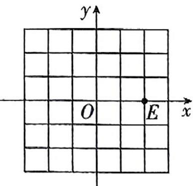

## 课时2 平面直角坐标系中点的坐标特征 刷提升

![[初中/课堂同步/教辅/必刷题/2026 八上必刷题 北师大数学/03_第三章/课时2_平面直角坐标系中点的坐标特征/questions/Q00106376.md]]
![[初中/课堂同步/教辅/必刷题/2026 八上必刷题 北师大数学/03_第三章/课时2_平面直角坐标系中点的坐标特征/questions/Q00106377.md]]
![[初中/课堂同步/教辅/必刷题/2026 八上必刷题 北师大数学/03_第三章/课时2_平面直角坐标系中点的坐标特征/questions/Q00105869.md]]
![[初中/课堂同步/教辅/必刷题/2026 八上必刷题 北师大数学/03_第三章/课时2_平面直角坐标系中点的坐标特征/questions/Q00105870.md]]
![[初中/课堂同步/教辅/必刷题/2026 八上必刷题 北师大数学/03_第三章/课时2_平面直角坐标系中点的坐标特征/questions/Q00105871.md]]
![[初中/课堂同步/教辅/必刷题/2026 八上必刷题 北师大数学/03_第三章/课时2_平面直角坐标系中点的坐标特征/questions/Q00105872.md]]
![[初中/课堂同步/教辅/必刷题/2026 八上必刷题 北师大数学/03_第三章/课时2_平面直角坐标系中点的坐标特征/questions/Q00105873.md]]

## 【应用】

(1) 若点 $A(-1, 1), B(2, 1)$ , 则 $AB$ 的长度为 \_\_\_\_.

(2) 若点 $C(1,0), CD \parallel y$ 轴, 且 $CD = 2$ , 则点 $D$ 的坐标为 \_\_\_\_.

【拓展】我们规定:平面直角坐标系中任意不重合的两点 $M(x_{1},y_{1}), N(x_{2},y_{2})$ 之间的折线距离为 $d(M,N)=|x_{1}-x_{2}|+|y_{1}-y_{2}|$ . 例如:图(1)中,点 $M(-1,1)$ 与点 $N(1,-2)$ 之间的折线距离为 $d(M,N)=|-1-1|+|1-(-2)|=2+3=5$ .

## 【解决问题】

(3)如图(2),已知 $E(2,0)$ ,若 $F(-1,-2)$ ,则 $d(E,F)=$ \_\_\_\_.

(4)如图(2)，已知 $E(2,0), H(1,t)$ ，若 $d(E, H) = 3$ ，求 $t$ 的值.

图(1)

图(2)

刷题先“痕”
