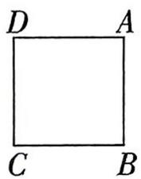

<!-- question-source:start -->
1[2025 湖北武汉校级质检]如图,已知正方形ABCD的边长为4,建立适当的平面直角坐标系,写出各个顶点的坐标.

(1)如果以点 C 为坐标原点,分别以 CB, CD 所在的直线为 x 轴、y 轴建立平面直角坐标系,那么各个顶点的坐标分别为 A \_\_\_\_, B \_\_\_\_, C(0,0), D\_\_\_\_;

(2)如果以点 A 为坐标原点,分别以 DA,AB 所在的直线为 x 轴、y 轴建立平面直角坐标系,那么各个顶点的坐标分别为 A(0,0),B\_\_\_\_,C\_\_\_\_,D\_\_\_\_;

(3)如果以正方形的中心为坐标原点,分别以平行于 $DA,AB$ 的直线为 $x$ 轴、 $y$ 轴建立平面直角坐标系,那么各个顶点的坐标分别为 $A\_\_\_\_,$ $B\_\_\_\_ ,C\_\_\_\_ ,D\_\_\_\_.$

<!-- question-source:end -->

![[Q00105874A1]]
