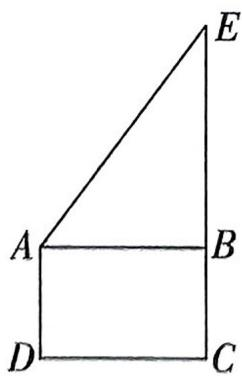

<!-- question-source:start -->
2[2024 甘肃酒泉期中]如图,在长方形 ABCD 中,已知 AB = 6, AD = 4, 在长方形 ABCD 外画 $\triangle ABE$ , 使 E 点在 CB 延长线上, AE = 10, 请建立适当的平面直角坐标系, 并求出各顶点的坐标.

<!-- question-source:end -->

![[Q00105875A1]]
