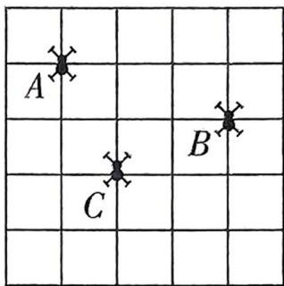

<!-- question-source:start -->
5[2025 山西太原质检]无人驾驶飞机简称“无人机”,英文缩写为“UAV”,是利用无线电遥控设备和自备的程序控制装置操纵的,或者由机载计算机完

全地或间歇地自主操作的不载人飞机. 如图, 飞行中的三架无人机按要求悬停在同一高度, 若无人机 A, B 的位置分别表示为 $(-1,3)$ , $(2,2)$ , 则无人机 C 的位置表示为 \_\_\_\_.
<!-- question-source:end -->

![[Q00105878A1]]
