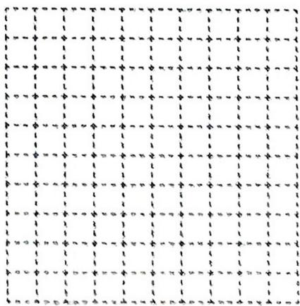

<!-- question-source:start -->
7 [2025 云南昆明期末] 在网格中画出合适的平面直角坐标系, 并在平面直角坐标系中描出下列各点: $A(-2,1), B(2,-2), C(2,3), D(0,1)$ , 连接 $AB, BD, DC, CA$ . 求所连线段围成图形的面积.

<!-- question-source:end -->

![[Q00105880A1]]
