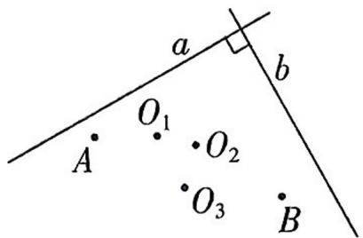

<!-- question-source:start -->
1. [中]如图, 直线 $a \perp b$ , 以平行于 $a$ 的直线为 $x$ 轴, 以平行于 $b$ 的直线为 $y$ 轴, 建立平面直角坐标系, 若 $A(-3,2), B(2,-3)$ , 则坐标系的原点最有可能是 ( )

$\cdot O_{4}$

A. $O_{1}$ B. $O_{2}$ C. $O_{3}$ D. $O_{4}$
<!-- question-source:end -->

![[Q00105881A1]]
