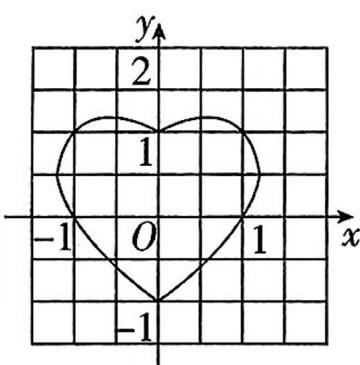

<!-- question-source:start -->
3[中]数学中有许多形状优美、寓意美好的曲线,建立如图所示的直角坐标系,曲线 C 就是其

中之一. 给出下列三个结论: ①曲线 C 恰好经过 6 个整点 (即横、纵坐标均为整数的点); ②曲线 C 在第一、二象限中的任意一点到原点的距离大于 1; ③曲线

C 所围成的“心形”区域的面积小于 3. 其中正确结论的序号是 ( )
A. ①
B. ②
C. ①②
D. ①②③
<!-- question-source:end -->

![[Q00105883A1]]
