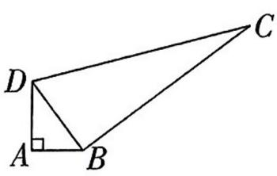
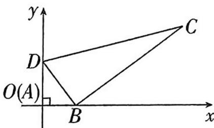

<!-- question-source:start -->
6[中]如图(1)所示,已知四边形ABCD, $\angle A=90^{\circ},AB=3\ m,BC=12\ m,CD=13\ m,DA=4\ m.$

(1)试说明: $BD \perp CB$ ;

(2)求四边形 $ABCD$ 的面积;

(3)如图(2),以 $A$ 为坐标原点,分别以 $AB,AD$ 所在直线为 $x$ 轴、 $y$ 轴建立直角坐标系,点 $P$ 在 $y$ 轴上,若 $S_{\triangle PBD} = \frac{1}{4} S_{\text {四边形}ABCD}$ ,求点 $P$ 的坐标.

图(1)

图(2)

<!-- question-source:end -->

![[Q00105886A1]]
