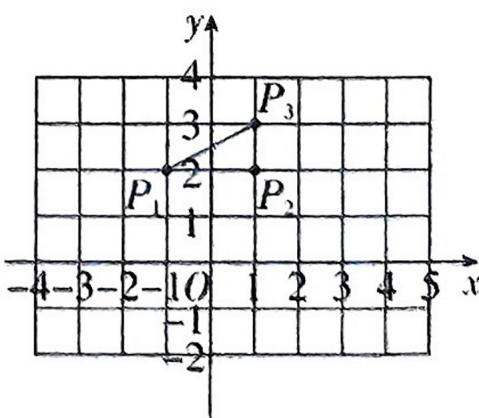

<!-- question-source:start -->
7 核心素养推理能力 [较难] 定义: 在平面直角坐标系 $xOy$ 中, 已知点 $P_{1}(a,b), P_{2}(c,b), P_{3}(c,d)$ , 这三个点中任意两点间的距离的最小值称为点 $P_{1}, P_{2}, P_{3}$ 的“最佳间距”. 例如: 如图, 点 $P_{1}(-1,2), P_{2}(1,2), P_{3}(1,3)$ 的“最佳间距”是 1.

(1)理解:点 $Q_{1}(2,1)$ , $Q_{2}(4,1)$ , $Q_{3}(4,4)$ 的“最佳间距”是\_\_\_\_.

(2) 探究: 已知点 $O(0,0), A(-3,0), B(-3,y)$ .

①若点 O, A, B 的“最佳间距”是 1, 求 y 的值;

②点 O, A, B 的“最佳间距”的最大值为 \_\_\_\_.

电子错题本鸭
<!-- question-source:end -->

![[Q00105887A1]]
