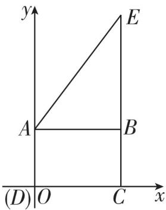

> [!success]- 必刷题
>
> > [!success] **【答案】** B
>
> > [!note]- **【解析】**
> > 【解】如图,以 D 为坐标原点,DC 和 AD 所在直线为 x 轴和 y 轴建立平面直角坐标系. 易知 A 的坐标是(0,4), B 的坐标是(6,4), C 的坐标是(6,0), D 的坐标是(0,
> >
> > 
> >
> > 0). 因为 $E$ 点在 $CB$ 延长线上, 所以 $\angle ABE = 90^{\circ}$ . 在 Rt $\triangle AEB$ 中, $EB = \sqrt{AE^{2} - AB^{2}} = \sqrt{10^{2} - 6^{2}} = 8$ , 则 $EC = 4 + 8 = 12$ , 则 $E$ 的坐标是 (6,12). (建系方法不唯一, 对应答案不唯一)
