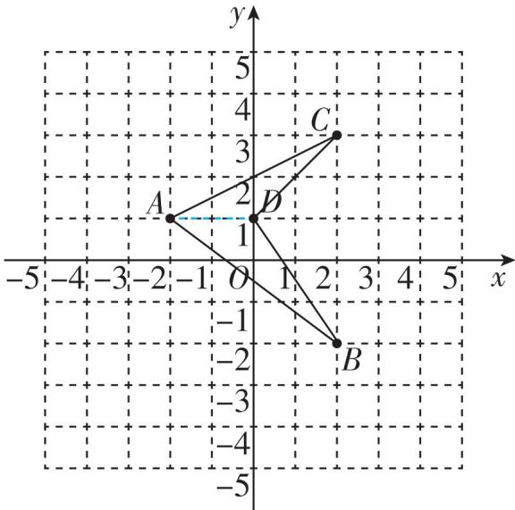

> [!success]- 必刷题
>
> > [!success] **【答案】** 详见解析
>
> > [!note]- **【解析】**
> > 添加辅助线 | 割补法求不规则图形面积在平面直角坐标系中, 当所求图形不是规则图形时, 割补法求面积是常用的方法. 通过作辅助线, 可以将所求图形补全成一个规则的图形, 其面积等于大图形的面积减去其他小图形的面积; 也可以将所求图形分割成几个规则的小图形, 其面积等于几个小图形面积的和.
> >
> > 【解】如图所示, 连接 AD, 所连线段围成图形的面积为 $\frac{1}{2} \times 2 \times 2 + \frac{1}{2} \times 2 \times 3 = 2 + 3 = 5$ .
> >
> > 
