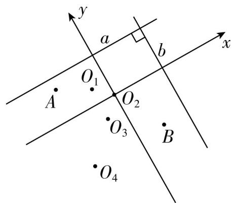
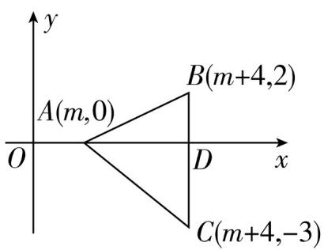

> [!success]- 必刷题
>
> > [!success] **【答案】** B
>
> > [!note]- **【解析】**
> > 如图, 因为 $A(-3, 2), B(2, -3)$ , 直线 $a \perp b$ , 以平行于 $a$ 的直线为 $x$ 轴, 以平行于 $b$ 的直线为 $y$ 轴, 所以建立如图所示的平面直角坐标系, 则坐标系的原点最有可能是 $O_{2}$ . 故选 B.
> >
> > 思路分析
> > 根据题意画出图形,得到 BC 的长,再利用勾股定理分别计算出 AB,AC 的长,即可判断.
> >
> > 思路分析
> > (1) 先根据勾股定理求出 BD 的长, 再根据勾股定理的逆定理证明 $BD \perp BC$ .
> >
> > （2）根据 $S_{四边形ABCD}=$ $S_{\triangle ABD} + S_{\triangle BCD}$ ,
> > 代入数据计算即可求解.
> >
> > (3) 先根据 $S_{\triangle PBD} = \frac{1}{4}S_{四边形ABCD}$ 求出 PD 的长, 再根据 D 点的坐标确定 P 点位置, 进而求解.
> >
> > 
> > (第1题图)
> >
> > 
> > (第2题图)
