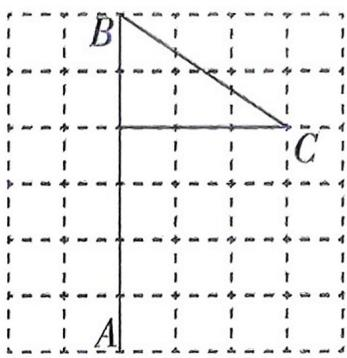
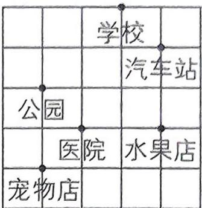

## 课时3 建立适当的平面直角坐标系求点的坐标 刷基础

## 刷基础

## 知识点 1 建立适当的平面直角坐标系求点的坐标

![[初中/课堂同步/教辅/必刷题/2026 八上必刷题 北师大数学/03_第三章/课时3_建立适当的平面直角坐标系求点的坐标/questions/Q00105874.md]]
![[初中/课堂同步/教辅/必刷题/2026 八上必刷题 北师大数学/03_第三章/课时3_建立适当的平面直角坐标系求点的坐标/questions/Q00105875.md]]

## 知识点2 确定有关点的位置

![[初中/课堂同步/教辅/必刷题/2026 八上必刷题 北师大数学/03_第三章/课时3_建立适当的平面直角坐标系求点的坐标/questions/Q00105876.md]]

## 建议用时 20 分钟 答案 D25

(第3题图)

(第4题图)

![[初中/课堂同步/教辅/必刷题/2026 八上必刷题 北师大数学/03_第三章/课时3_建立适当的平面直角坐标系求点的坐标/questions/Q00105877.md]]
![[初中/课堂同步/教辅/必刷题/2026 八上必刷题 北师大数学/03_第三章/课时3_建立适当的平面直角坐标系求点的坐标/questions/Q00105878.md]]

## 知识点 3 建立平面直角坐标系求相关图形的面积

![[初中/课堂同步/教辅/必刷题/2026 八上必刷题 北师大数学/03_第三章/课时3_建立适当的平面直角坐标系求点的坐标/questions/Q00105879.md]]
![[初中/课堂同步/教辅/必刷题/2026 八上必刷题 北师大数学/03_第三章/课时3_建立适当的平面直角坐标系求点的坐标/questions/Q00105880.md]]
