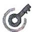

![[初中/课堂同步/教辅/必刷题/2026 八上必刷题 北师大数学/04_第四章_一次函数/1_函数/questions/Q00105922.md]]

## 刷基础

## 知识点1 函数的概念

![[初中/课堂同步/教辅/必刷题/2026 八上必刷题 北师大数学/04_第四章_一次函数/1_函数/questions/Q00105923.md]]
![[初中/课堂同步/教辅/必刷题/2026 八上必刷题 北师大数学/04_第四章_一次函数/1_函数/questions/Q00105924.md]]
![[初中/课堂同步/教辅/必刷题/2026 八上必刷题 北师大数学/04_第四章_一次函数/1_函数/questions/Q00105925.md]]

## 知识点 2 函数的表示方法

![[初中/课堂同步/教辅/必刷题/2026 八上必刷题 北师大数学/04_第四章_一次函数/1_函数/questions/Q00105926.md]]
![[初中/课堂同步/教辅/必刷题/2026 八上必刷题 北师大数学/04_第四章_一次函数/1_函数/questions/Q00105927.md]]

## 知识点 3 自变量的取值范围与函数值

![[初中/课堂同步/教辅/必刷题/2026 八上必刷题 北师大数学/04_第四章_一次函数/1_函数/questions/Q00105928.md]]
![[初中/课堂同步/教辅/必刷题/2026 八上必刷题 北师大数学/04_第四章_一次函数/1_函数/questions/Q00105929.md]]
![[初中/课堂同步/教辅/必刷题/2026 八上必刷题 北师大数学/04_第四章_一次函数/1_函数/questions/Q00105930.md]]
