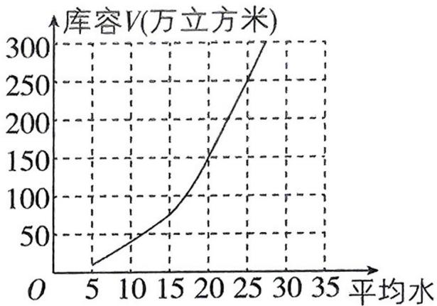

<!-- question-source:start -->
5[2025 浙江温州调研]如图是某水库的平均水深 $x$ (米)与库容 $V$ (万立方米)之间的关系图象. 根据图象回答下面的问题:

(1) 将表格填写完整：

<table><tr><td>x(米)</td><td>5</td><td>10</td><td>15</td><td>20</td><td>25</td></tr><tr><td>V(万立方米)</td><td>10</td><td>40</td><td>75</td><td></td><td></td></tr></table>

建议用时 20 分钟 密案 D31

(2)当平均水深 $x$ 取5米至25米之间的一个确定的值时,相应的库容 $V$ 唯一确定吗?

(3)库容 $V$ 可以看成平均水深 $x$ 的函数吗?

深x(米)
<!-- question-source:end -->

![[Q00105927A1]]
