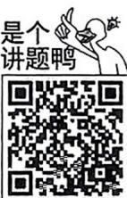

<!-- question-source:start -->
3[广西柳州中考]如图, 直线 $y_{1}=x+3$ 分别与 x 轴、y 轴交于点 A 和点 C, 直线 $y_{2}=-x+3$ 分别与 x 轴、y 轴交于点

B 和点 C, 点 $P(m,2)$ 是 $\triangle ABC$ 内部(包括边上)的一点, 则 m 的最大值与最小值之差为 ( )
A. 1 B. 2 C. 4 D. 6
<!-- question-source:end -->

![[Q00106025A1]]
