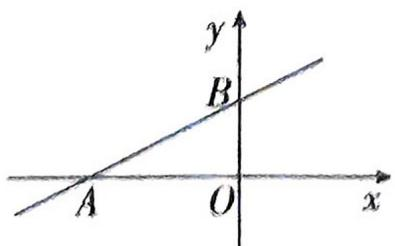

<!-- question-source:start -->
5[2024 江苏扬州中考]如图, 已知一次函数 $y = kx + b (k \neq 0)$ 的图象分别与 $x, y$ 轴交于 $A, B$ 两点, 若 $OA = 2, OB = 1$ , 则关于 $x$ 的方程 $kx + b = 0$ 的解为 \_\_\_\_.

建议用时 30 分钟 答案 D46
<!-- question-source:end -->

![[Q00106027A1]]
