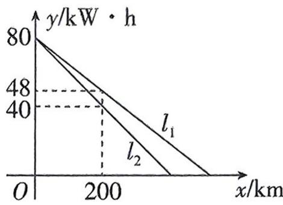

<!-- question-source:start -->
6[2024 山东济南中考]某公司生产了 A, B 两款新能源电动汽车. 如图, $l_{1}, l_{2}$ 分别表示 A 款, B 款新能源电动

汽车充满电后电池的剩余电量 $y(\mathrm{kW} \cdot \mathrm{h})$ 与汽车行驶路程 $x(\mathrm{km})$ 的关系. 当两款新能源电动汽车的行驶路程都是 300 km 时, A 款新能源电动汽车电池的剩余电量比 B 款新能源电动汽车电池的剩余电量多 \_\_\_\_ kW·h.
<!-- question-source:end -->

![[Q00106028A1]]
