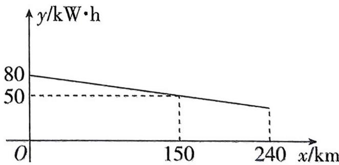

<!-- question-source:start -->
7 [2024 陕西中考] 我国新能源汽车快速健康发展, 续航里程不断提升, 王师傅驾驶一辆纯电动汽车从 A 市前往 B 市. 他驾车从 A 市一高速公路入口驶入时, 该车的剩余电量是 $80 \mathrm{~kW} \cdot \mathrm{h}$ , 行驶了 $240 \mathrm{~km}$ 后, 从 B 市一高速公路出口驶出. 已知该车在高速公路上行驶的过程中, 剩余电量 $y(\mathrm{kW} \cdot \mathrm{h})$ 与行驶路程 $x(\mathrm{km})$ 之间的关系如图所示.

(1) 求 $y$ 与 $x$ 之间的关系式;

(2)已知这辆车的“满电量”为 $100 \mathrm{kW} \cdot \mathrm{h}$ , 求王师傅驾车从 B 市这一高速公路出口驶出时,该车的剩余电量占“满电量”的百分之多少.

<!-- question-source:end -->

![[Q00106029A1]]
