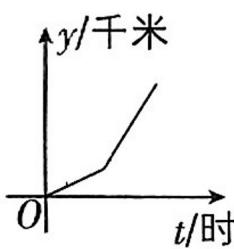
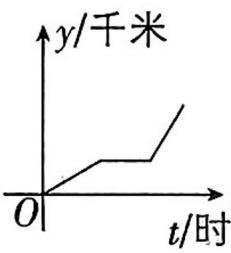
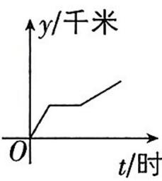
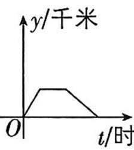

<!-- question-source:start -->
2 李叔叔开车上班, 最初以某一速度匀速行驶,中途停车加油耽误了几分, 为了按时到单位,李叔叔在不违反交通规则的前提下加快了速度,仍保持匀速行驶,则汽车行驶的路程 y(千米)与行驶的时间 t(时)的函数关系的大致图象是 ( )

A

B

C

D
<!-- question-source:end -->

![[Q00106031A1]]
