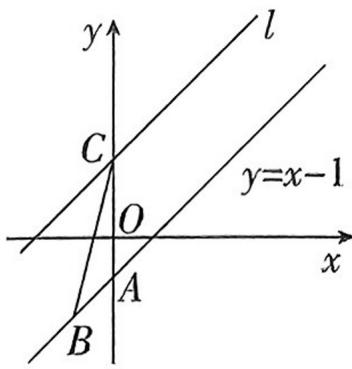
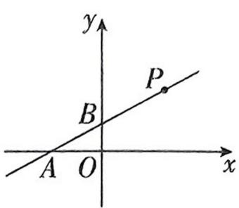

<!-- question-source:start -->
4[2025 内蒙古包头校级期中]如图, 直线 y = x - 1 与 y 轴交于点 A, 点 B(b, -2) 在直线 y = x - 1 上. 将直线 y = x - 1 向上平移 m 个单位长度得到直线 l, 直线 l 与 y 轴交于点 C, 若 $\triangle ABC$ 的面积为 $\frac{3}{2}$ , 则 m 的值为 ( )
A. 2    B. 3    C. 6    D. 4

(第4题图)
(第5题图)
<!-- question-source:end -->

![[Q00106033A1]]
