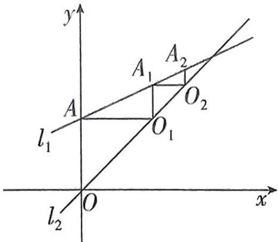

<!-- question-source:start -->
8[2024 四川绵阳涪城区期末]已知函数 $y = |x - 2a|$ ( $a$ 为常数), 当 $1 \leqslant x \leqslant 3$ 时, $y$ 的最小值为5, 则 $a$ 的值为 \_\_\_\_.

9《庄子·天下篇》记载“一尺之棰, 日取其半, 万世不竭”. 如图, 直线 $l_{1}: y = \frac{1}{2} x + 1$ 与 $y$ 轴交于点 $A$ , 过点 $A$ 作 $x$ 轴的平行线交直线 $l_{2}: y = x$ 于点 $O_{1}$ , 过点 $O_{1}$ 作 $y$ 轴的平行线交直线 $l_{1}$ 于点 $A_{1}$ , 以此类推, 令 $OA = a_{1}, O_{1}A_{1} = a_{2}, \cdots, O_{n-1}A_{n-1} = a_{n}$ , 若 $a_{1} + a_{2} + \cdots + a_{n} \leqslant S$ 对任意大于 1 的整数 $n$

恒成立,则 S 的最小值为 \_\_\_\_.

<!-- question-source:end -->

![[Q00106037A1]]
