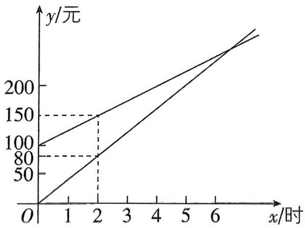

<!-- question-source:start -->
10[2025 山东烟台期末]某羽毛球馆有两种收费方式: A 种是办理会员卡后每小时按优惠价付费, 但需按月缴纳一定的会员费; B 种是不办会员卡直接按打球时间付费, 两种收费方式每月的收费情况如图所示, 根据图中提供的信息解答下列问题.

(1) A 种方式要求客户每月支付的会员费是\_\_\_\_元, B 种方式每小时打球收费\_\_\_\_元;

(2)求出 A 种方式的月费用 y(元)与打球时间 x(时)之间的函数关系式;

(3)小王每月打球时间为10小时,他选用哪种收费方式更合算?

<!-- question-source:end -->

![[Q00106038A1]]
