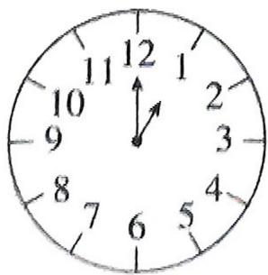

<!-- question-source:start -->
11 新考法 [2025 福建宁德期中] 某数学兴趣小组以“钟表上时针和分针的重合次数”为课题进行研究. 研究发现: 时针每分转 0.5 度, 分针每分转 6 度, 并且从某时刻开始, 经过的时间与时针和分针的重合次数存在一定的关系. 如图是某钟表的简化平面示意图, 此刻时间恰好为 1:00.

(1) 此刻分针和时针的夹角为 \_\_\_\_ 度；

(2)兴趣小组为了研究经过的时间与时针和分针重合次数之间的关系,制作如下表格,其中x(次)表示从1:00开始,时针和分针重合的次数,y(分)表示从1:00开始经过的时间,请将表格填写完整.

<table><tr><td>x/次</td><td>1</td><td>2</td><td>3</td><td>...</td></tr><tr><td>y/分</td><td> $\frac{60}{11}$ </td><td>_</td><td>_</td><td>...</td></tr></table>

(3) 直接写出 $y$ 与 $x$ 之间的函数关系式, 并求从 1:00 开始经过 24 时时, 分针和时针重合的次数.
<!-- question-source:end -->

![[Q00106039A1]]
