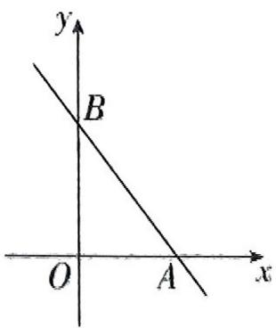
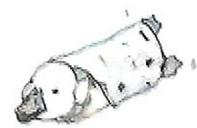

<!-- question-source:start -->
12 如图, 在平面直角坐标系中, 已知一次函数 $y = -\frac{4}{3}x + 4$ 的图象分别与 x 轴、y 轴交于点 A, B.

(1) 点 A 的坐标是\_\_\_\_, 点 B 的坐标是\_\_\_\_.

(2) 若点 $C(m,6)$ 是直线 $y = -\frac{4}{3} x + 4$ 上一点, 则直线 $OC$ 的表达式是

(3)在直线 $AB$ 上是否存在一点 $D$ (不与点 $B$ 重合),使 $\triangle AOD$ 的面积等于 $\triangle OAB$ 的面积?若存在,求出点 $D$ 的坐标;若不存在,请说明理由.

(4) 点 E 是 y 轴上一动点, 把线段 AB 沿着直线 AE 翻折, 使点 B 落在 x 轴上, 请直接写出折痕所在直线的表达式.

套路！全是套路！

电子错题本鸭
<!-- question-source:end -->

![[Q00106040A1]]
