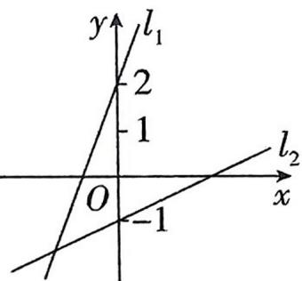
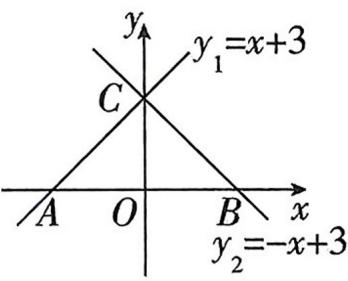

<!-- question-source:start -->
2. [2024 内蒙古通辽中考]如图,在同一平面直角坐标系中,一次函数 $y=k_{1}x+b_{1}$ 与 $y=k_{2}x+b_{2}$ (其中 $k_{1}k_{2}\neq0,k_{1},k_{2},b_{1},b_{2}$ 为常数) 的图象分别为直线 $l_{1},l_{2}$ . 下列结论正确的是 ( )
A. $b_{1}+b_{2}>0$ B. $b_{1}b_{2}>0$ C. $k_{1}+k_{2}<0$ D. $k_{1}k_{2}<0$

(第2题图)

(第3题图)
<!-- question-source:end -->

![[Q00106391A1]]
