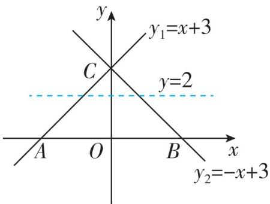

> [!success]- 必刷题
>
> > [!success] **【答案】** B
>
> > [!note]- **【解析】**
> > 因为点 $P(m,2)$ 是 $\triangle ABC$ 内部(包括边上)的一点, 所以点 P 在直线 y=2 上, 如图所示. 当 P 为直线 y=2 与直线 $y_{2}$ 的交点时, m 取最大值, 当 P 为直线 y=2 与直线 $y_{1}$ 的交点时, m 取最小值. 因为在 $y_{2}=-x+3$ 中, 令 y=2, 则 x=1, 在 $y_{1}=x+3$ 中, 令 y=2, 则 x=-1, 所以 m 的最大值为 1, 最小值为 -1. 故 m 的最大值与最小值之差为 $1-(-1)=2$ . 故选 B.
> >
> > 
> >
> > 关键点拨
> > 关键要理解当P在何处时m存在最大值与最小值,由于P的纵坐标为2,故作出直线y=2有助于判断P的位置.
