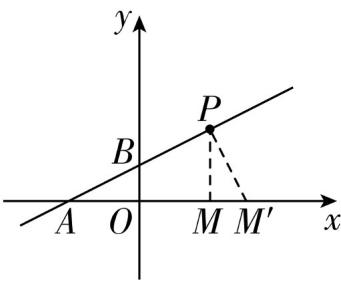

> [!success]- 必刷题
>
> > [!success] **【答案】** B
>
> > [!note]- **【解析】**
> > 因为直线 $l: y = \frac{1}{2}x + m$ 交 y 轴于点 B(0,1)，所以 $1 = \frac{1}{2} \times 0 + m$ ，解得 m = 1，则直线 l 的表达式为 $y = \frac{1}{2}x + 1$ 。当 y = 0 时， $\frac{1}{2}x + 1 = 0$ ，解得 x = -2，所以点 A 的坐标为 $(-2,0)$ 。
> > 当 y = 2 时， $\frac{1}{2}n + 1 = 2$ ，解得 n = 2，所以点 P 的
> >
> > 如图,分两种情况考虑:
> > - **①**：当 $\angle AMP = 90^{\circ}$ 时, $PM \perp x$ 轴, 则点 M 的坐标为 $(2,0)$ .
> >
> > 
> > - **②**：当 $\angle APM' = 90^{\circ}$ 时,设点 $M'$ 的坐标为(a,0),则 $AP^{2} = [2 - (-2)]^{2} + (2 - 0)^{2} = 20$ , $AM'^{2} = [a - (-2)]^{2} = a^{2} + 4a + 4$ , $PM'^{2} = (2 - a)^{2} + (2 - 0)^{2} = a^{2} - 4a + 8$ .因为 $AP^{2} + PM'^{2} = AM'^{2}$ ,所以 $20 + a^{2} - 4a + 8 = a^{2} + 4a + 4$ ,解得a=3,所以点 $M'$ 的坐标为(3,0).综上所述,点M的坐标为(2,0)或(3,0).
> >
> > 故选 **B**.
