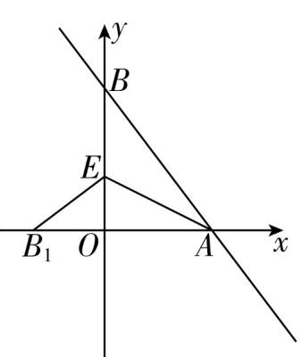
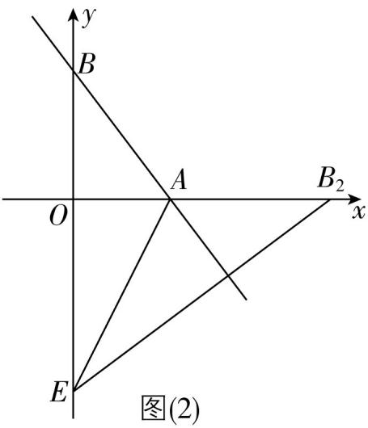

> [!success]- 必刷题
>
> > [!success] **【答案】** D
>
> > [!note]- **【解析】**
> > 【解】(1)令 $x = 0$ , 则 $y = 4$ , 所以 $B(0,4)$ . 令 $y = 0$ , 则 $x = 3$ , 所以 $A(3,0)$ . 故答案为 (3, 0), (0,4).
> >
> > (2) 将点 $C(m,6)$ 代入 $y = -\frac{4}{3} x + 4$ , 得 $-\frac{4}{3} m + 4 = 6$ , 解得 $m = -\frac{3}{2}$ , 所以 $C\left(-\frac{3}{2}, 6\right)$ . 设直线 $OC$ 的表达式为 $y = kx (k \neq 0)$ , 则 $-\frac{3}{2} k = 6$ , 解得 $k = -4$ , 所以 $y = -4x$ . 故答案为 $y = -4x$ .
> >
> > 关键点拨
> > (3) 由(2)得到从第一次重合后, 每隔 $\frac{720}{11}$ 分, 时针与分针再次重合是解题的关键.
> >
> > 思路分析
> > (4) 设 $E(0, n)$ ，当 B 点的对应点 $B_{1}$ 在 x 轴负半轴上时，在 $Rt\triangle B_{1}EO$ 中， $(4-n)^{2}=4+n^{2}$ ，可求得 $E\left(0,\frac{3}{2}\right)$ ；当 B 点的对应点 $B_{2}$ 在 x 轴正半轴上时，在 $Rt\triangle OEB_{2}$ 中， $(4-n)^{2}=n^{2}+64$ ，可求得 $E(0,-6)$ 。再由待定系数法求直线 AE 的表达式即可。
> >
> > (3) 直线 AB 上存在点 D，使 $\triangle AOD$ 的面积等于 $\triangle OAB$ 的面积.
> >
> > 设 $D\left(t, -\frac{4}{3}t + 4\right)$ ，所以 $S_{\triangle AOD} = \frac{1}{2} \times 3 \times \left| -\frac{4}{3}t + 4 \right|$ ， $S_{\triangle OAB} = \frac{1}{2} \times 3 \times 4 = 6$ 。因为 $\triangle AOD$ 的面积等于 $\triangle OAB$ 的面积，所以 $\frac{1}{2} \times 3 \times \left| -\frac{4}{3}t + 4 \right| = 6$ ，解得 t = 0（舍去）或 t = 6，所以 $D(6, -4)$ 。
> >
> > (4) $y = -\frac{1}{2}x + \frac{3}{2}$ 或 y = 2x - 6。
> >
> > 设 $E(0, n)$ 。如图(1)，当 B 点的对应点 $B_{1}$ 在 x 轴负半轴上时，由翻折可知 $BE = B_{1}E = 4 - n, AB = AB_{1} = \sqrt{3^{2} + 4^{2}} = 5$ 。因为 OA = 3，所以 $OB_{1} = 2$ 。在 Rt $\triangle B_{1}EO$ 中， $(4 - n)^{2} = 4 + n^{2}$ ，解得 $n = \frac{3}{2}$ ，所以 $E\left(0, \frac{3}{2}\right)$ ，所以直线 AE 的表达式为 $y = -\frac{1}{2}x + \frac{3}{2}$ 。如图(2)，当 B 点的对应点 $B_{2}$ 在 x 轴正半轴上时，由翻折可知， $BE = B_{2}E = 4 - n, AB = AB_{2} = 5$ ，所以 $OB_{2} = 8$ 。在 Rt $\triangle OEB_{2}$ 中， $(4 - n)^{2} = n^{2} + 64$ ，解得 n = -6，所以 $E(0, -6)$ ，所以直线 AE 的表达式为 y = 2x - 6。综上所述，折痕所在直线的表达式为 $y = -\frac{1}{2}x + \frac{3}{2}$ 或 y = 2x - 6。
> >
> > 
> > 图(1)
> >
> > 
> >
> > 的二元一次方程, 所以 m=1, n-2=1, 解得 m=1, n=3.
> >
> > 故选 **D**.
